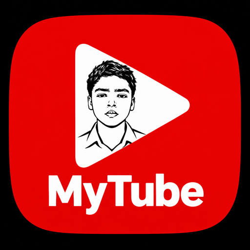

#  MyTube

Android, iOS, and Desktop app for YouTube and YouTube Music.

Maintained by **Abu Huraira**.

MyTube is based on the open-source [NouTube](https://github.com/nonbili/NouTube) project and is licensed under the AGPL-3.0.

## Features

- No ads
- Plays in the background
- Manage video/music library without login
- Manage watch history without login
- Download video
- RSS feed reader for YouTube channels
- Hide shorts
- Live chat
- Play original audio
- Customize with CSS

## How it works

- Wrap https://m.youtube.com and https://music.youtube.com in Android webview
- Inject code to block ads
- Hook playback controls and support playing in background

## Screenshots

  

## Contributing

You can find [contributing instructions here](/CONTRIBUTING.md)

## Credits

MyTube would not exist without the original [NouTube](https://github.com/nonbili/NouTube) project by Nonbili Inc. and its contributors.

## Note

We're not affiliated with YouTube, Google, or any .org websites.
